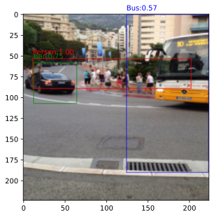
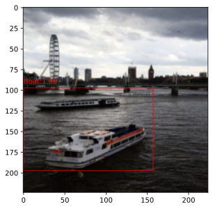
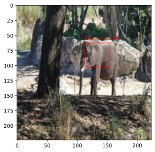

# GradDetect-Explainable-Object-Detection

## Quick Overview
GradDetect is a project designed for **Explainable Object Detection** using the **Grad-CAM** (Gradient-weighted Class Activation Mapping) technique. Grad-CAM provides visual explanations for decisions made by Convolutional Neural Network (CNN)-based models, making them more transparent and interpretable.

---

## The Math
Grad-CAM uses the gradients of any target concept (e.g., a specific object class), flowing into the last convolutional layer to produce a coarse localization map highlighting the important regions in the image for predicting the concept.

### 1. Neuron Importance Weights ($\alpha_k^c$)
The weight $\alpha_k^c$ represents the importance of feature map $k$ for a target class $c$. It is computed by performing a global average pooling of the gradients of the score for class $c$ ($y^c$) with respect to the feature maps $A^k$:

$$\alpha_k^c = \frac{1}{Z} \sum_i \sum_j \frac{\partial y^c}{\partial A_{ij}^k}$$

Where:
- $y^c$ is the score for class $c$ (before Softmax/Sigmoid).
- $A^k$ is the $k$-th feature map of the convolutional layer.
- $Z$ is the number of pixels in the feature map (width $\times$ height).

### 2. Class Activation Map ($L_{Grad-CAM}^c$)
We then perform a weighted combination of forward activation maps and follow it by a ReLU to obtain the heatmap:

$$L_{Grad-CAM}^c = \text{ReLU}\left( \sum_k \alpha_k^c A^k \right)$$

Applying **ReLU** ensures that we only focus on features that have a *positive* influence on the class of interest.

**Citation:**
> Selvaraju, R. R., Cogswell, M., Das, A., Vedantam, R., Parikh, D., & Batra, D. (2017). Grad-CAM: Visual Explanations from Deep Networks via Gradient-Based Localization. In *Proceedings of the IEEE International Conference on Computer Vision (ICCV)*.

---

## Dataset Used
The project uses the **Common Objects in Context (COCO 2017)** dataset, which contains over 100K images and 80 target classes.

### Setup Instructions:
1. Download the following from [cocodataset.org](https://cocodataset.org/#download):
    - `train2017` images
    - `val2017` images
    - `2017 Train/Val annotations`
2. Unzip and place the content in the following structure:
   ```text
   <project_root>/data/coco2017/annotations
   <project_root>/data/coco2017/train2017
   <project_root>/data/coco2017/val2017
   ```

---

## Model & Training
### Architecture
The project supports pretrained **VGG13 with Batch Normalization** and **ResNet18**. Models can be loaded using the `src.models.load_model()` function.

### Training Strategy
- **Layer Unfreezing:** Training is performed by unfreezing the classification head and a specified number of convolutional blocks near the head. This is controlled by the `trainable_blocks` argument in `load_model(model_name, trainable_blocks)`.
- **Loss Function:** Binary Cross Entropy (**BCE**) is used for multi-class (multi-label) labeling.
- **Targets:** The target label for each image is represented as a **multi-hot vector**.

---

## Detection & Visualization
The `detect_objects` function in `src.detection` handles the inference pipeline:
1. **Heatmaps:** Generates Grad-CAM heatmaps for each object detected.
2. **Bounding Boxes:** Renders bounding boxes based on the heatmap intensities.
3. **Confidence Scores:** Provides a score ranging between $(0, 1]$ for each detection.

---

## Running The Code
1. **Environment Setup:** Create a conda environment and install all necessary packages:
   ```bash
   conda create -n graddetect python=3.12
   conda activate graddetect
   pip install torch torchvision torchaudio pillow numpy matplotlib jupyter
   ```
2. **Execution:** To see the first working prototype, run the Jupyter notebook:
`notebooks/script.ipynb`

### Image Preprocessing
For proper inference, it is **critical** to preprocess each test image as follows:
1. **Resize:** $224 \times 224$ pixels.
2. **Scale:** Convert pixel values to the range $[0, 1]$.
3. **Normalize:** Use the following statistics:
   - `mean = [0.485, 0.456, 0.406]`
   - `std = [0.229, 0.224, 0.225]`

**Note on Performance:**
The initial prototype was trained for only 20 epochs (taking ~14 hours). While the results show promise, the performance is limited by the training duration. Longer training is recommended for production-grade accuracy.

<div>
  
  
  
  <p><i>Some decent results from the trained model.</i></p>
</div>

---

## Future Work
- **Improve:** Improve model performance by training for more epochs.
- **Upgrade:** Replace the current Grad-CAM-based localization approach, which often produces oversized bounding boxes and cannot distinguish between individual object instances, with a more sophisticated object detection pipeline capable of accurately localizing and differentiating between instances of the same class.
- **Optimize:** Implement Cross-Validation (CV) and Hyperparameter Optimization (HPO) techniques, such as SMAC, to systematically tune model hyperparameters and improve generalization.

---

<sub>*This README was written with the assistance of AI, while the project structure, technical decisions, and content outline are my own.*</sub>
